# Docker resource names are lowercased by the Docker adapter

## Problem

Cell resource names are built from the issue and project (`paracell-<Project>-<Issue>`)
by `domain.SafeResourceName`, which keeps uppercase letters. Docker / Docker Compose
treat several of these names in lowercase (Compose project names must be lowercase),
so a Cell such as `ABC-123` produces names that do not match what Docker reports and
container creation or cleanup fails.

## Design

Lowercasing is a Docker-specific rule, so it lives in the Docker adapter only. The
domain keeps its names unchanged (tmux sessions, worktree paths, and state are not
affected).

`DockerCLIAdapter` normalizes the `ContainerResources` it receives at its entry
points (`CreateContainers`, `CleanContainers`) before any `docker` command is built:

- `ContainerResources.Network` → lowercase
- `ContainerResource.Name` of `Target` items → lowercase
- `Dependency` items are left as-is: their name is the user's existing Compose
  service, which must match exactly.
- Copied volume names (`copiedVolumeName`) → lowercase

```mermaid
classDiagram
    direction LR

    class ContainerGateway {
        <<interface / usecase port>>
        +CreateContainers(ctx, ContainerResources) map[string][]string, error
        +CleanContainers(ctx, ContainerResources) error
    }

    class DockerCLIAdapter {
        +Runner system.Runner
        +Root string
        +CreateContainers(ctx, ContainerResources) map[string][]string, error
        +CleanContainers(ctx, ContainerResources) error
        -resolveComposeService(ctx, name) string, error
        -rollbackContainerStage(...) error
        -ensureGateway(ctx, network) error
        -disconnectGateway(ctx, network) error
    }

    class dockerNameNormalizer {
        <<functions (new)>>
        +dockerResourceName(name string) string
        +normalizeDockerResources(ContainerResources) ContainerResources
    }

    class ContainerResources {
        <<domain>>
        +CellName string
        +Project string
        +Network string
        +Items []ContainerResource
    }

    class ContainerResource {
        <<domain>>
        +Name string
        +SourceContainer string
        +Mode Mode
        +SourcePath string
    }

    class copiedVolumeName {
        <<function>>
        +copiedVolumeName(scope, container, destination) string
    }

    ContainerGateway <|.. DockerCLIAdapter
    DockerCLIAdapter ..> dockerNameNormalizer : normalizes input first
    DockerCLIAdapter ..> copiedVolumeName
    copiedVolumeName ..> dockerNameNormalizer : lowercase volume name
    dockerNameNormalizer ..> ContainerResources : Network → lowercase
    ContainerResources "1" *-- "many" ContainerResource
    dockerNameNormalizer ..> ContainerResource : Target Name → lowercase\nDependency unchanged
```

## Tests

- `CreateContainers` with an uppercase Cell runs `docker network create`, `docker run --name`
  and the Compose project label with lowercase names, while the Dependency service filter keeps
  its original name.
- `CleanContainers` removes the lowercase container and network names.
- `copiedVolumeName` returns a lowercase name.
